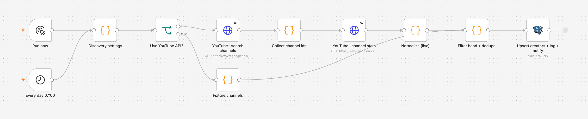
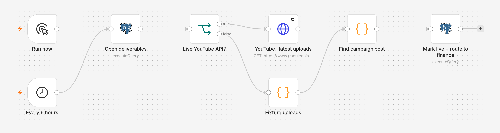
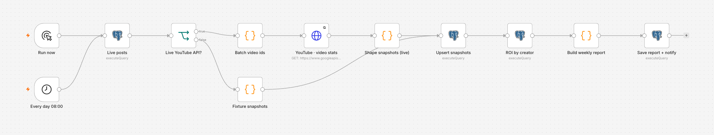
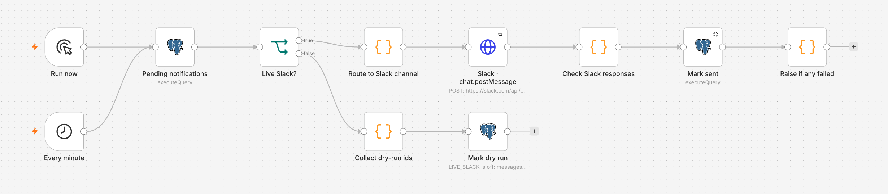
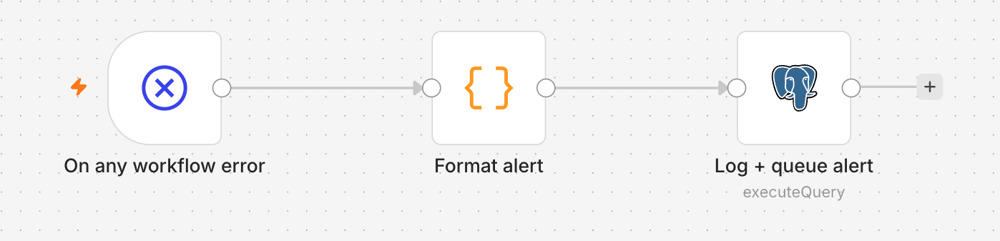

# Creator Ops Mini

A small, working version of an influencer/creator program's automation layer, built with **n8n + Postgres**.
It covers the pipeline from finding creators to the weekly ROI report. Every step is idempotent, audited and alert-backed.

I built it for the *Automation Engineer – Influencers* application at ElevenLabs. It is an independent demo and is not affiliated with ElevenLabs.

```
            ┌──────────────── 00 · Error handler ◄── any workflow fails (max 1 alert / workflow / hour)
            │
01 Discovery ─► creators ─► 03 Reminders ─► 04 Tracking ─► payments ─► 05 Metrics ─► reports
 YouTube search   (CRM)      due in 48h /    tracking code   (invoice     YouTube stats   ROI per
 follower band               overdue         in a new video   to finance)  daily snapshot  creator
            │                    │                 │                            │
            └────────────────────┴──── notifications (outbox) ◄─────────────────┘
                                              │
                                   06 Dispatcher ─► Slack  (or dry-run when Slack is off)

                  every state change ─► events (append-only audit trail)
```

## In the n8n editor







The workflows that call YouTube (01, 04, 05) have a **Live YouTube API?** switch: the upper branch calls the real API, the lower one uses fixtures with the same shape.

## What each workflow does

| # | Workflow | Trigger | What it does |
|---|---|---|---|
| 00 | **Error handler** | any workflow error | Logs the failure to `events` and queues one alert per workflow per hour to `#automation-alerts`, so a broken API can't flood the channel |
| 01 | **Creator discovery → CRM sync** | daily 07:00 | Searches YouTube by brand keywords, keeps creators inside the follower band, de-duplicates, and upserts them into `creators`. It then posts a summary of new creators |
| 03 | **Content reminders** | daily 09:00 | Messages creators whose post is due within 48 h. It also flags overdue posts to the team. Each reminder is sent once per day at most |
| 04 | **Content tracking** | every 6 h | Checks contracted creators' new uploads for the campaign tracking code. When it finds a match, it records the live link and marks the creator live. It also routes the invoice to finance |
| 05 | **Metrics → ROI report** | daily 08:00 | Stores a daily snapshot of views, likes and comments. It then computes cost per engagement and CTR per creator, and saves a weekly report |
| 06 | **Notification dispatcher** | every minute | Delivers the outbox to Slack and checks Slack's `ok` field, because Slack returns HTTP 200 even when it fails. Failed messages stay pending and are retried |

Not built yet: onboarding and contract generation (e-signature), and the payment-status webhook (Stripe). The `payments` table and the "invoice ready" hand-off in 04 are where those plug in.

## Reliability choices

- **Idempotent by design.** Every write is an upsert on a natural key (`channel_id`, `platform_post_id`, `(deliverable, day)`, `dedupe_key`), so any workflow can be re-run safely. A second full run creates no duplicate creators and sends no duplicate messages.
- **Audit trail.** `events` is append-only: Postgres rules turn `UPDATE` and `DELETE` on it into no-ops. You can ask "who changed this creator's status, and when?" with one query.
- **Outbox, not direct calls.** Workflows never call Slack themselves. They queue to `notifications`, and one dispatcher delivers. If Slack is down nothing is lost, and the whole system runs in **dry-run** with Slack turned off.
- **Errors surface.** All workflows share one error workflow. It was tested on scheduled runs with a deliberately broken YouTube key: two failures were logged and only one alert was queued.
- **Retries.** External HTTP nodes retry 3 times, 2 s apart.
- **Secrets.** API keys live only in n8n's encrypted credential store. The repo ships empty placeholders. `.env` only holds on/off flags and is git-ignored.
- **One query per step.** Each Postgres node receives one JSON batch and does its work in a single statement with data-modifying CTEs. That makes the step atomic: the upsert, the audit row and the notification succeed or fail together.

## Data model

`creators` · `campaigns` · `deliverables` · `metrics_daily` · `payments` · `events` · `notifications` · `reports` and the `campaign_roi` view. See [db/schema.sql](db/schema.sql).

```sql
-- cost per engagement and CTR per creator, from each post's latest snapshot
SELECT handle, cost_eur, views, engagements, cost_per_engagement, ctr_pct
FROM campaign_roi ORDER BY cost_per_engagement NULLS LAST;
```

## Run it

Requirements: Node 24+ and Postgres 17. Both are on Homebrew: `brew install node@24 postgresql@17`.

```bash
npm install
npm run setup     # local Postgres on :5433, schema + seed, imports all workflows
npm run run:all   # runs 01 → 03 → 04 → 05 → 06 once and prints what each did
npm start         # n8n editor at http://localhost:5678
```

Example output of `npm run run:all` on a fresh setup:

```
✓ 01 → Upsert creators + log + notify: new_creators 4, refreshed 3, skipped_out_of_band 2
✓ 03 → Queue reminders + overdue alerts: reminders_queued 1, overdue_alerts_queued 1
✓ 04 → Mark live + route to finance: verified_live 1, invoices_routed 1
✓ 05 → Save report + notify: report_id 1
✓ 06 → Mark dry run: 6 messages recorded
```

### Fixture mode vs. live mode

By default every external call uses **fixtures**: fictional channels, uploads and stats shaped exactly like the YouTube API responses. The demo therefore runs with no accounts or keys. To go live:

1. Put a YouTube Data API key in the **YouTube Data API key** credential in the n8n UI, and/or a bot token in **Slack bot (creator-ops)**.
2. `cp .env.example .env` and set `LIVE_YOUTUBE=true` / `LIVE_SLACK=true`.

Instagram and TikTok need app review for their APIs. In production they would be extra branches beside the YouTube one, feeding the same normalized shape. Click tracking would come from the link shortener's API. YouTube doesn't report clicks, so live mode records 0.

## Repo layout

```
workflows/            n8n workflow exports (import-ready)
scripts/build_workflows.py   generates workflows/ — one place for shared retry policy, credentials, error handler
db/schema.sql, seed.sql      tables, audit rules, ROI view; demo campaign with three contracted creators
credentials/          empty credential placeholders (no secrets)
scripts/              setup, run_all, env
```

## How I built it

I designed the data model, the workflow boundaries and the reliability rules. I built the system with an AI coding agent (Claude Code), then reviewed it and tested it end to end. That testing found two real bugs, both fixed:
- The ROI view summed cumulative snapshots, which overstated views by about 3×.
- The report's week start was off by one day because JS and Postgres disagreed on timezones.

It also surfaced an n8n 2.x behaviour: an error workflow only runs if it is published.
